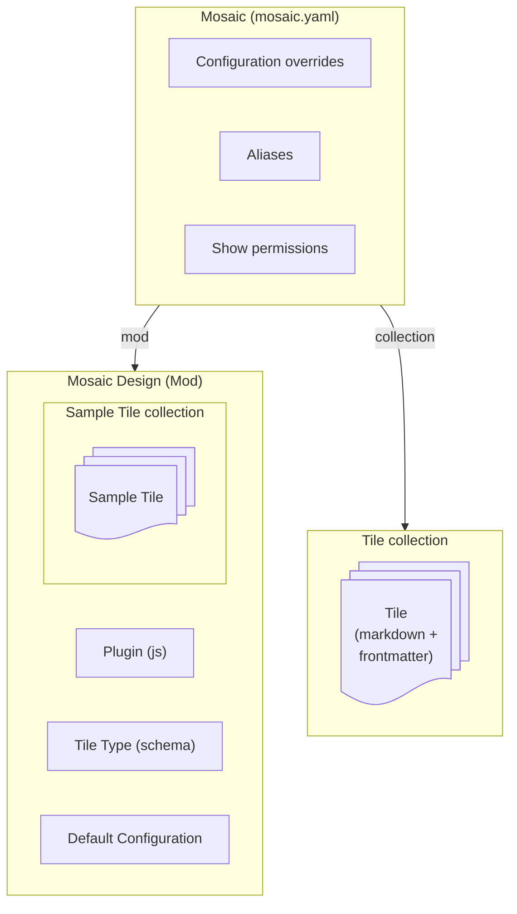
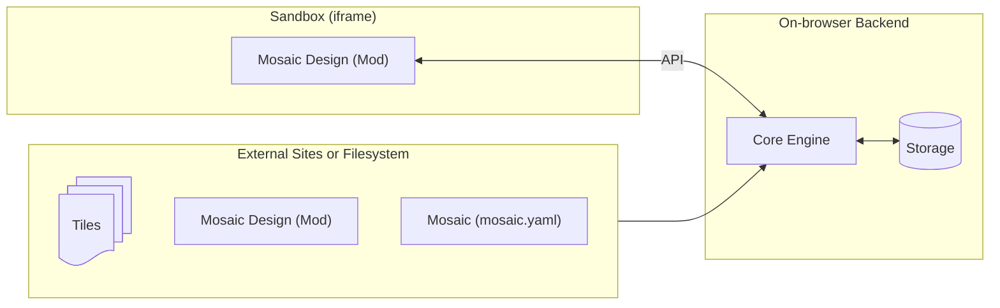

# OpenTesela Format Specification

## Glossary

- **Tile**: Markdown document containing a piece of information and metadata in its frontmatter.
- **Tile Type**: Schema in yaml format that allow to valid a Tile as belonging to a certain type based on its metadata. It follows structural typing principles.
- **Tile Collection**: List of tiles paths or urls in yaml format.
- **Mosaic Design (Mod)**: Javascript plugin that allows to visualize and interact with a collection of tiles of a given tile type. 
- **Mosaic**: Shareable yaml file that opens a mosaic design with a tile collection: it overrides the mod's configuration, maps the collection's field names to the mod's tile type and declares the media hosts the tiles need.

## Architecture Overview

### Mosaic

A mosaic is a file that names two other things: a mod and, optionally, a tile collection. The tile collection contains the tiles to be displayed, each one a markdown file with metadata in its frontmatter. The mod includes the javascript plugin, the tile type required by the plugin, its default configuration and a sample tile collection with example tiles. The mosaic file holds only what this pairing needs: the configuration values that override the mod's defaults, the aliases that rename the collection's fields to the tile type's, and the `show` permissions for the hosts of the tiles' media. Mod, collection and mosaic can each live on a different site.



### Sandbox

Mods run isolated inside a sandbox (iframe) and can only communicate with the core engine through an API. The core engine works as an on-browser backend: it reads and writes data in the storage and loads tiles, mods and mosaics from external sites or the filesystem. Mods have no direct access to the storage or to external sources.



### Portability principles

OpenTesela is implemented as a Single Page Application design to be self hosted via static files like github pages. The project can be clones and put tiles, mods and mosaics inside the dedicated folder in order that the app load them by default.
OpenTesela could be also loaded in a html file and initialized from there without the need of cloning the full project, the default tiles, mods and mosaics can be defined during initialization.
A third way of using OpenTesela is by setting a mosaic path as parameter in the url via hash routing (`#/run?mosaic=<path or url>`). In this way user can share a mosaic by only sharing a link.

## Tiles and Tile Collections

A Tile is a markdown file with frontmatter containing metadata. 

Tile example:
```
---
title: "Fahrenheit 451"
date: "1953-10-19"
authors:
  - "Ray Bradbury"
country: "United States"
language: "English"
genres:
  - "Dystopian fiction"
  - "Science fiction"
pages: 156
image: "./fahrenheit_451.jpg"
---

Fahrenheit 451 is a 1953 dystopian novel by American writer Ray Bradbury. It presents a future American society where books have been outlawed and "firemen" burn any that are found...

Source: https://en.wikipedia.org/wiki/Fahrenheit_451
```

Metadata strings starting with `./` or `../` are paths next to the tile: mods receive `./fahrenheit_451.jpg` as an absolute URL, resolved against the tile's location, so the image can sit beside the tile.

Metadata strings that are absolute `http:` or `https:` URLs of images, audio or video load in any mod without a permission, from any public site. Link the file itself, at its final address: not a page, a folder or a link that redirects to another site. See [Media linked by tiles](modules/lib/core/sandbox/README.md#media-linked-by-tiles).

Tiles are organized in collections inside a yaml file. They are used as indexes of paths or urls, for example a collection of tiles named `science_fictions_books.yaml`:
```yaml
collection:
  name: "Science fiction books"
  description: "A sample book list for demonstration purposes."
  tiles:
    - url: "https://.../books/the_martian_chronicles.md"
    - url: "https://.../books/farenheit_451.md"
    - url: "https://.../books/foundation.md"
    - path: "./books/brave_new_world.md"
    - path: "./books/1984.md"
    - path: "./books/kallocain.md"
    - path: "./short_stories/the_library_of_babel.md"
```

## Tile Types

A tile represents a piece of multidimensional information thanks to its metadata that allows to assign different types. Tile Types are yaml schemas defined in the frontmatter section of markdown files. They define interfaces via structural typing (i.e. define the minimum properties to be present in order to validate its belonging to a type). They are based on JSON Type Definition (JTD) like in the library `ajv`, for example a definition for a type named book:
```
---
schema:
  definitions:
    book:
      properties:
        title:
          type: string
        date:
          type: string
        authors:
          elements:
            type: string
        country:
          type: string
        genres:
          elements:
            type: string
      optionalProperties:
        language:
          type: string
      additionalProperties: true
  ref: book
---

# Book Type

Type for defining a very simple book metadata.
```

More generic types can be defined. For example a simple event type can be define for any metadata containing a title and a date:
```yaml
schema:
  definitions:
    simple_event:
      properties:
        title:
          type: string
        date:
          type: string
      additionalProperties: true
  ref: simple_event
```

Or a country location type for any metadata containing a title and a country:
```yaml
schema:
  definitions:
    country_location:
      properties:
        title:
          type: string
        country:
          type: string
      additionalProperties: true
  ref: country_location
```

## Mosaic Designs (mod)

Mosaic Designs (Mod) are javascript plugins that allow to visualize and interact with a collection tiles of a given type. Each mod has a required tile type and they define the minimum fields that must be present in the metadata of the tile in order to be shown in the mod UI (i.e structural typing). Input tiles that have missing fields will be ignored with a warning.

A same tile could be compatible with multiple mods if they have the required fields.

Mods use configuration files called mod_conf.yaml for defining mod metadata and configuration default values. For example for a mod called "country_markers_map" that shows input tiles organized by country in a map:
```yaml
mod:
  name: "country_markers_map"
  title: "Country Markers Map"
  version: "1.0.0"
  description: "An interactive world map that display tiles as markers organized by country."
  entrypoint: "./main.js"
  type_path: "./schema.yaml"
  config:
    map:
      center: [0, 0.0] # [latitude, longitude]
      zoom: 2
      base_layer: "openstreetmap"
    markers:
      color: "#3366cc"
      size: 12
    popup:
      show_image: true
      show_body: false
```

## Mosaic

A mosaic is the final product presented to the users where they can interact with tiles using the mod UI. OpenTesela opens it from a mosaic yaml file, `mosaic.yaml` in a folder by convention, that ties together a mod and a tile collection. It can change the mod's default configuration values, add aliases that rename the tiles' metadata fields to the names of the mod's tile type, for increasing compatibility, and declare the hosts the tiles' images come from. For example, for the "country_markers_map" mod above:

```yaml
mosaic:
  title: "Science Fiction Books Around the World"
  description: "Classic science fiction novels placed on a map by country of origin."

  # Mod used to render the collection: a folder, a mod file, or a default mod name.
  mod: "../mods/country_markers_map"

  # Tile collection to display: a folder holding collection.yaml, or the file itself.
  collection: "./science_fiction_books.yaml"

  # Deep-merged into the mod's config: mappings are merged, other values replace.
  config:
    map:
      center: [-34.6085, -58.3722]
      zoom: 3
    markers:
      color: "#aa3333"
    popup:
      show_body: true

  # For each field of the mod's tile type, the names this collection uses for it.
  aliases:
    title:
      - "name"
      - "book_name"
    country:
      - "origin"
      - "pub_country"
    date:
      - "pub_date"
      - "published"

  # Only show permissions: the hosts the tiles' media come from.
  permissions:
    show:
      - host: "https://covers.openlibrary.org"
        reason: "Shows the book covers"
```

Paths in the file are resolved against the file's own location. The mosaic opens with the link `#/run?mosaic=<path or url>`. The format, the merge and alias rules and the module are described in the [mosaic module](modules/lib/mosaic/README.md).
